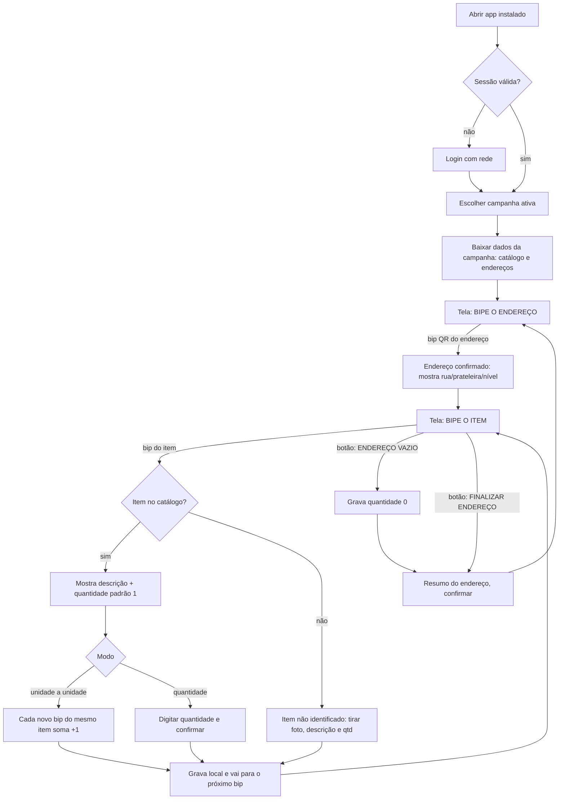
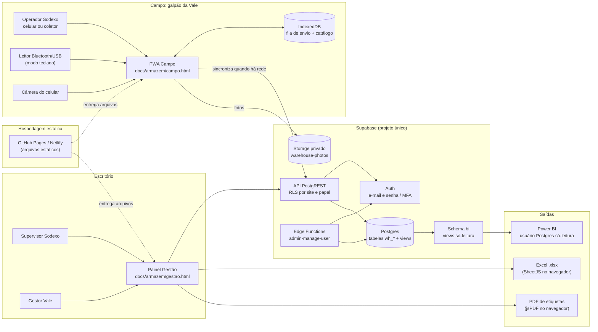
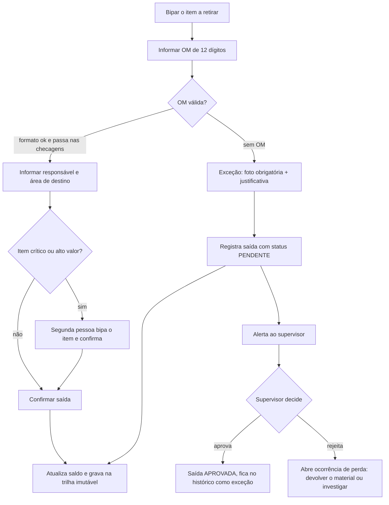

# Proposta — Módulo "Armazém" (Site VGR) do TerraVia Ops

> **Status:** apenas análise e desenho. Nenhum código do produto foi alterado.
> **Data:** 15/10/2026
> **Leitura sugerida:** seções 0 e 1 (o que descobri e minha recomendação), depois 11 (prevenção de perdas, que **reordena as fases**), 7 e 9 (fases e perguntas). O resto é o detalhamento.
> **Atualização:** a seção 11 foi acrescentada para o requisito de prevenção e rastreio de perdas. Onde ela altera algo das seções anteriores, há um aviso no ponto correspondente.

---

## 0. Uma correção importante sobre o ponto de partida

Seu texto descreve o repositório como "Streamlit + Supabase". Ao analisar o código, vi que **o Streamlit é só o MVP antigo**. Os arquivos `app.py`, `database.py`, `style.py` e `.streamlit/` usam SQLite local e um calendário PCM/PCO, e o próprio `CLAUDE.md` manda ignorá-los.

O produto real em uso com a Vale é:

| Camada | O que existe de verdade |
|---|---|
| Frontend | **Um único arquivo** `docs/index.html` (10.582 linhas de HTML + CSS + JS puro, sem framework e sem build). `dashboard.html` na raiz é uma cópia idêntica. |
| Backend | **Supabase** (Postgres + Auth + Storage + RLS). Você roda o SQL à mão no SQL Editor (`supabase/schema.sql`, 1.066 linhas, idempotente). |
| Funções de servidor | 2 Edge Functions em Deno/TypeScript (`admin-manage-user`, `whatsapp-alerts-worker`). |
| Hospedagem | GitHub Pages **e** Netlify em paralelo, ambos publicando a pasta `docs/`. |
| App instalável | PWA simples: `docs/manifest.json` + `docs/sw.js`, que só guarda em cache o "shell" do app. |

**Consequência:** a opção (a) da sua pergunta, "tudo em Streamlit", **não é uma extensão natural** deste repositório. Seria introduzir uma segunda tecnologia, num servidor Python que hoje não existe. A conversa de arquitetura (seção 2) é, na prática, entre estas duas:

- **(b1)** Um módulo novo no mesmo estilo do que já existe (HTML/JS puro + Supabase).
- **(b2)** Um app Streamlit novo só para gestão.

Recomendo a **(b1)**, e explico o porquê adiante.

---

## 1. Como o módulo se encaixa no que já existe (sem quebrar nada)

### 1.1 O que você já tem e vai reaproveitar

| Peça existente | Onde está | Como o módulo novo usa |
|---|---|---|
| Login (e-mail e senha, Supabase Auth) | `index.html:6565` | A sessão fica no `localStorage` do domínio. Um app novo servido no **mesmo domínio** (`/armazem/`) enxerga a mesma sessão, então o usuário loga uma vez só. |
| `profiles` (perfil por usuário, com `role`) | `schema.sql:58` | Ganha 3 papéis novos (seção 3.8). |
| `sites` + `profile_sites` | `schema.sql:31` e `:104` | **O armazém VGR é um `site`.** Quem tem o site em `profile_sites` enxerga o módulo. |
| `has_site_access(site_key)` | `schema.sql:425` | Já aplica o recorte de empresa. É a base de **toda** política RLS do módulo novo, igual `inspections` e `portaria_liberacoes`. |
| `is_admin()`, `current_role_key()`, `my_company()` | `schema.sql:396` e seguintes | Reaproveitados nas políticas. |
| `audit_log` | `schema.sql:328` | **Não serve** para o armazém: as colunas são específicas de agendamento (`tag`, `area_code`, `agendamento_horario`). Haverá um log próprio (seção 3.7). |
| Edge Function `admin-manage-user` | `supabase/functions/` | Cria os usuários do armazém sem mudança de mecanismo. Preciso conferir se ela valida a lista de roles (ainda não li o arquivo inteiro). |
| SheetJS (`xlsx@0.18.5`) | `index.html:17` | Já exporta Excel no app. A exportação do armazém usa a mesma biblioteca. |
| Padrão visual | variáveis CSS `--bg-main`, `--bg-card`, `--border-color`, `.kpi-card`, `.modal-box` (tema escuro) | Copiado para o módulo novo, para ficar com a mesma cara. |
| Padrão de "tipo de site" como checkbox independente | `correias_panel` / `isCorreiasSite()` | **O armazém segue o mesmo padrão.** Vira `sites.warehouse_module boolean`, um checkbox, e **não** um 4º tipo exclusivo. |

### 1.2 Atenção: o tipo "Contrato de Controle de Materiais" já existe e é outra coisa

O `SITE_TYPE_OPTIONS` (`index.html:2821`) tem o tipo `materiais` ("Armazém"), usado por Fábrica e Viga Materiais. Ali, "armazém" significa um contrato de **limpeza e atividades** em áreas de almoxarifado: as tags são sub-áreas e há Hora Perdida e Atividade Extra. **Não há estoque nem inventário.**

O módulo novo é de natureza diferente: ele controla item, endereço e quantidade. Por isso:

- Não reaproveitar o tipo `materiais`. Criar o flag independente `warehouse_module`, como a Sala de Controle fez com `correias_panel`.
- Um mesmo site pode ter os dois (limpeza do armazém **e** inventário do armazém), sem conflito.
- **Pergunta para você:** "VGR" é um site novo (por exemplo, Vargem Grande) ou é o "Viga Materiais" que já está cadastrado? Isso muda só o cadastro, não o desenho.

### 1.3 O que NÃO deve ser tocado

1. **`docs/index.html`** não deve receber o módulo. É um arquivo de 10,5 mil linhas, em produção com a Vale, e toda mudança exige manter `dashboard.html` idêntico. Colocar ali um módulo com offline, câmera, mapa e KPIs aumentaria o risco de quebrar o piloto. O módulo novo vive numa **pasta própria** (`docs/armazem/`).
2. **`supabase/schema.sql`** deve ficar como está, com no máximo uma linha de ligação. As tabelas novas vão num **arquivo SQL separado** (`supabase/armazem.sql`), no mesmo estilo idempotente. Assim o schema de limpeza e o de armazém evoluem sem se atrapalhar, e o módulo pode ser instalado em outro projeto Supabase se a TI da Vale exigir.
3. **A lista `profiles_role_check`** é reescrita inteira a cada rodada do schema (`schema.sql:86-97`). Ao adicionar papéis novos, é preciso incluir **todos** os papéis atuais **mais** os novos, senão usuários existentes ficam inválidos.
4. **`index.html` com um papel desconhecido.** O `ROLE_META` (`index.html:2062`) não conhece os papéis novos. Não verifiquei como o login reage a isso. **Antes de criar o primeiro usuário `ARM_*`, é preciso testar o que acontece se ele abrir o app antigo**, por exemplo com um redirecionamento para `/armazem/`. Isso vai para a lista de riscos.

### 1.4 Lições do próprio projeto que valem para o módulo novo

O `CLAUDE.md` registra problemas reais que o módulo novo vai reencontrar:

- **Atualização automática no meio de uma escrita causa corrida de dados.** Foi o que levou à regra `mobileWriteInFlight` e à reversão do gatilho por `visibilitychange`, porque tirar foto já dispara esse evento. No app de campo do armazém, **nenhum refresh automático pode rodar com itens pendentes ou a câmera aberta**.
- **`reconcileBookings`.** Ao atualizar listas vindas do servidor, faça merge nos objetos existentes. No armazém a fila de envio (outbox) é a "fonte da verdade local", e o refresh nunca deve sobrescrevê-la.
- **O Service Worker atual atualiza só no segundo reload.** O app de campo precisa de um aviso explícito de "nova versão disponível, atualizar depois de enviar os pendentes". Não pode depender de dois reloads.
- **Limite de 1.000 linhas por consulta do Supabase.** O app já tem `fetchAllRows`. Contagens de inventário passam fácil de 1.000 linhas, então relatórios e painéis precisam de paginação ou de agregação no banco.
- **Offline hoje só existe para leitura.** O Encarregado tem um "snapshot" no `localStorage` (`saveSiteSnapshot`, `applyEncarregadoOfflineSnapshot`) para abrir o app sem sinal. **Não existe fila de escrita offline.** A do armazém será a primeira e precisa ser desenhada com cuidado (seção 2).

---

## 2. Arquitetura de campo: recomendação

### 2.1 Os requisitos que decidem

| Requisito | Por que pesa |
|---|---|
| Bipar dezenas de itens seguidos | Cada bip não pode esperar rede. A resposta (som e vibração) tem que ser imediata. |
| Leitor que funciona como teclado | O leitor "digita" o código e termina com Enter. A tela precisa **manter o foco** num campo de texto o tempo todo. |
| Câmera do celular | Leitura contínua de vídeo, com acesso à API da câmera. |
| Sem sinal dentro do galpão | Gravar local e sincronizar depois (fila offline). |
| Celular corporativo | Instalar sem loja de apps, de preferência por link ou MDM. |

### 2.2 Por que Streamlit não serve para a ponta (campo)

Didaticamente, o Streamlit funciona assim: **a cada interação o servidor Python reexecuta o script** e manda a tela de volta por WebSocket. Para um painel de gestão isso é ótimo. Para bipar 40 itens seguidos, é um problema:

| Critério | Streamlit | PWA (HTML/JS) |
|---|---|---|
| Latência por bip | Ida e volta ao servidor a cada bip (centenas de ms, ou segundos com sinal ruim) | Gravação local em IndexedDB (poucos ms) |
| Funciona offline | **Não.** A tela vive no servidor. | **Sim.** Os arquivos ficam no aparelho e os dados na fila local. |
| Foco no campo do leitor | Frágil. A cada rerun o foco pode se perder. | Controle total (`focus()`, `inputmode="none"`) |
| Câmera com leitura contínua | Só via componente de terceiros com WebRTC (pesado). O `st.camera_input` tira **uma foto**, não lê em vídeo. | `BarcodeDetector` ou ZXing direto no navegador |
| Som e vibração no bip | Limitado | Web Audio e `navigator.vibrate` |
| Instalar no celular | Abre como site, sem modo offline | PWA instalável |
| Servidor para manter | Sim, um servidor Python novo (custo e operação) | **Não.** É arquivo estático, como o app atual. |

### 2.3 Recomendação

**Um app de campo em PWA (HTML/JS puro, sem build), no mesmo Supabase, em pasta própria.** Para a gestão, um segundo HTML da mesma pasta, em desktop e role-gated. Não recomendo Streamlit nem para a gestão, porque:

1. Você teria dois frontends e duas stacks para manter, com "fator de ônibus 1".
2. Os dados e as regras de segurança já estão no Supabase (RLS). O painel só desenha tela, e isso o HTML/JS faz tão bem quanto.
3. O Streamlit exigiria um servidor com custo, monitoramento e mais uma peça para a avaliação de segurança da TI da Vale.

Estrutura proposta:

```
docs/armazem/
  index.html      -> porta de entrada: login + decide para onde mandar (campo ou gestão) pelo papel
  campo.html      -> app de campo (mobile, offline, scanner)
  gestao.html     -> supervisor e gestão Vale (desktop: progresso, mapa, KPIs, exportação)
  comum.js        -> cliente Supabase, sessão, helpers, IndexedDB/outbox, estilos compartilhados
  sw.js           -> Service Worker PRÓPRIO (escopo /armazem/), não mexe no sw.js raiz
  manifest.json   -> PWA próprio ("TerraVia Armazém"), start_url próprio
supabase/armazem.sql   -> tabelas, RLS, views, funções (idempotente, como o schema.sql)
```

> **Por que um Service Worker separado?** O `docs/sw.js` atual trata qualquer caminho terminado em `/index.html` e qualquer `/assets/` como "shell" e usa stale-while-revalidate. Um escopo separado (`/armazem/`) evita que as duas lógicas de cache se misturem.
>
> **Por que quebrar em arquivos, se o projeto é "um HTML só"?** Aquele estilo faz sentido para o app antigo. Aqui o campo e a gestão têm públicos, dispositivos e riscos diferentes. O arquivo de campo precisa ser **pequeno e estável**, porque roda em celular sem sinal. Mesmo assim continua sem build: são só 3 ou 4 arquivos estáticos.

### 2.4 Como cada requisito de campo é atendido

**Leitor Bluetooth/USB (modo teclado).**

- Um `<input>` sempre focado, com `inputmode="none"`. Isso impede o teclado virtual de abrir e deixa o leitor "digitar" nele.
- O leitor termina o código com **Enter** (ou Tab; é configurável no leitor). O app reage ao Enter.
- Se o foco se perder (toque na tela, diálogo), o app o devolve ao campo ao fechar a ação.
- Os prefixos/sufixos do leitor são configuráveis. Vale padronizar na compra: **sufixo CR (Enter) e sem prefixo**.

**Câmera do celular.**

- Na API nativa `BarcodeDetector` (Chrome/Android), basta pedir os formatos (`qr_code`, `code_128`, `ean_13`...). É rápida e não precisa de biblioteca.
- Em aparelhos sem ela (principalmente iPhone/Safari), uma biblioteca de fallback (ZXing). **Fixar a versão exata**, porque o `CLAUDE.md` já aponta que o `supabase-js@2` solto é um risco.
- Modo contínuo: a câmera fica aberta, lê, toca o bip e já volta a ler (com pausa de ~1 s para não ler o mesmo código duas vezes).

**Feedback de leitura.**

- Bip curto (Web Audio, tom diferente para sucesso, erro e "item não encontrado") e `navigator.vibrate()`.
- Atenção: o **iPhone não vibra** pelo navegador. Se os celulares corporativos forem iPhone, o feedback será só som e cor da tela. Pergunta para a Sodexo.

**Offline de verdade (a parte mais delicada).**

```
bipar -> grava na fila local (IndexedDB) -> mostra na tela -> [sincroniza quando houver rede]
```

1. **Cada contagem nasce com um `id` UUID gerado no aparelho.** Se o envio for repetido (cai a rede no meio), o servidor reconhece o mesmo `id` e **ignora a duplicata** (`upsert ... ignoreDuplicates`). Isso se chama **idempotência**, e é o que impede contar duas vezes.
2. **A fila é a fonte da verdade no aparelho.** O refresh do servidor nunca a apaga.
3. **Sincronização** acontece: ao voltar a rede (evento `online`), a cada N segundos com sinal, por botão manual "Enviar agora" e ao fechar um endereço. Em lotes de ~50, com retentativa progressiva.
4. **Indicador sempre visível:** "● 142 pendentes". O logout **fica bloqueado** enquanto houver pendentes.
5. **Baixar os dados da campanha antes de entrar no galpão:** catálogo de itens (código, descrição) e a lista de endereços da campanha, também em IndexedDB. Assim o bip resolve "que item é esse?" **sem rede**. O saldo esperado **não** é baixado (contagem cega).
6. **Fotos:** comprimidas no aparelho (~1280 px, ~150 KB), guardadas como blob na fila e enviadas depois do registro da contagem. O caminho do arquivo é gerado junto com o `id`.
7. **Relógio errado:** guardamos `counted_at` (hora do aparelho) e `received_at` (hora do servidor, `default now()`). Relatórios usam a do servidor para auditar.
8. **Login offline:** o login precisa ser feito com rede, no início do turno. A sessão fica guardada e funciona offline. O token de acesso expira, mas isso só importa na hora de sincronizar (renova com rede). O refresh token dura bastante, mas confirme se o projeto usa a opção de "tempo máximo de sessão" ou "inatividade" do Supabase (planos pagos).
9. **iOS e o armazenamento local:** o Safari pode apagar dados de sites pouco usados. Pedir `navigator.storage.persist()` e orientar a instalar o app na tela inicial reduz esse risco. Ainda assim, **o procedimento operacional deve exigir sincronizar ao fim de cada turno**.

> **Honestidade sobre o risco:** o offline é a parte onde mais pode dar errado em campo (aparelho trocado no meio do turno, cache apagado, bateria). Por isso a Fase 1 tem um item só para testes de offline em campo (seção 7).

**Instalação nos celulares corporativos.**

- Android/Chrome: abrir o link e "Adicionar à tela inicial". Se a Sodexo tem MDM (Intune, Workspace ONE...), dá para empurrar o PWA para todos os aparelhos.
- A TI da Vale pode bloquear domínios como `github.io` ou `netlify.app`. Um **domínio próprio** (ex.: `armazem.suaempresa.com.br`) evita esse bloqueio. Pergunta para a Vale.

---

## 3. Modelo de dados

### 3.0 Princípios (o porquê das escolhas)

1. **Tudo carrega `site_key`.** É o padrão do projeto: `has_site_access(site_key)` já resolve empresa e permissão. Não inventamos um segundo mecanismo de multi-tenant.
2. **Prefixo `wh_`** (de *warehouse*) em todas as tabelas, para não se misturar com `bookings`, `equipment` etc.
3. **Contagem é "append-only"** (só se acrescenta, não se edita). Uma contagem registrada nunca é alterada nem apagada; correções são novos registros. É o que dá valor de auditoria perante a Vale.
4. **Quem decide o que é "verdade" é uma ação humana registrada** (aprovação do supervisor), separada dos eventos brutos.
5. **Views de leitura usam `security_invoker`.** No Postgres/Supabase, uma view comum roda com os direitos do dono e **ignora a RLS**. Para a RLS continuar valendo, as views são criadas com `with (security_invoker = true)`. Esse é um erro clássico e importante.

### 3.1 Endereçamento físico

Armazém → rua → prateleira → nível → posição, numa **única tabela em árvore** (`wh_locations`) com `parent_id`.

| Campo | Para quê |
|---|---|
| `id` uuid PK | Identificador interno |
| `site_key` | Recorte de contrato/armazém |
| `parent_id` | Aponta para o nível acima (rua é filha do armazém...) |
| `kind` | `ARMAZEM`, `RUA`, `PRATELEIRA`, `NIVEL`, `POSICAO` |
| `code` | Código curto no nível (ex.: `A`, `03`, `2`) |
| `full_code` | Código completo (ex.: `VGR-A-03-2-05`), único por site |
| `qr_token` | Texto curto e aleatório que vai no QR (ex.: `7K3F9Q`) |
| `is_countable` | Se é nesse nível que se conta (normalmente `NIVEL` ou `POSICAO`) |
| `map_x, map_y, map_w, map_h` | Posição da rua no mapa (opcionais, usados no mapa visual) |
| `active` | Endereço desativado não some do histórico |

**Por que uma tabela em árvore e não 5 tabelas?** É mais fácil para o mapa e para somar "% concluído da rua" (basta agrupar pelos filhos), e permite armazéns que não usam todos os níveis. O custo é uma consulta recursiva na criação, mas isso é raro.

**Conteúdo do QR do endereço:** `TVA1|L|<qr_token>` (por exemplo, `TVA1|L|7K3F9Q`). O prefixo `TVA1|L|` permite ao app saber, ao ler, se é um **endereço (L)** ou um **item**, porque o código de barras do item vem da etiqueta da Vale e tem outro formato. Código curto = QR menos denso = leitura mais confiável de longe, importante para prateleiras altas.

Índices: `unique (site_key, full_code)`, `unique (site_key, qr_token)`, `index (site_key, parent_id)`.

### 3.2 Catálogo de itens

**`wh_items`**

| Campo | Observação |
|---|---|
| `id`, `site_key` | |
| `code` | ID/código interno do item. `unique (site_key, code)` |
| `vale_material_code` | Código SAP ou outro, **opcional**, `index (site_key, vale_material_code)` |
| `description`, `uom` | Descrição e unidade (UN, CX, M...) |
| `active` | |

**`wh_item_barcodes`** (um item pode ter vários códigos: EAN, QR da Vale, código interno)

| Campo | Observação |
|---|---|
| `item_id` | |
| `site_key` | Repetido de propósito, para a RLS e o índice ficarem simples |
| `barcode` | O texto exatamente como o leitor entrega |
| `unique (site_key, barcode)` | O bip procura por aqui, rápido |

> **Por que separar os códigos?** Hoje você ainda não sabe o formato das etiquetas (pergunta 1 da seção 8). Com a tabela separada, qualquer formato novo entra sem alterar a estrutura.

### 3.3 Campanhas de inventário

| Tabela | Principais campos |
|---|---|
| **`wh_campaigns`** | `id`, `site_key`, `name`, `kind` (`GERAL` / `CICLICO`), `start_date`, `end_date`, `status` (`RASCUNHO`, `ATIVA`, `FECHADA`, `CANCELADA`), `blind boolean default true`, `recount_mode` (`NENHUMA`, `DIVERGENCIA`, `AMOSTRA`, `TODAS`), `recount_sample_pct`, `tolerance_qty`, `tolerance_pct` |
| **`wh_teams`** | `id`, `site_key`, `name` |
| **`wh_team_members`** | `team_id`, `profile_id` |
| **`wh_campaign_assignments`** | `campaign_id`, `location_id` (normalmente a **rua**), `team_id`, `round` (1ª, 2ª contagem) |

`wh_campaign_assignments` é o que diz "a equipe X conta a rua A na 1ª contagem e a equipe Y recontar a rua A na 2ª", garantindo que **quem faz a segunda contagem seja outra pessoa**.

### 3.4 Contagens (o coração do módulo)

**`wh_count_events`** — imutável, uma linha por "bip confirmado".

| Campo | Observação |
|---|---|
| `id` uuid PK | **Gerado no aparelho** (idempotência, ver 2.4) |
| `site_key`, `campaign_id`, `location_id` | |
| `item_id` | Nulo se for item não identificado |
| `unidentified_id` | Aponta para `wh_unidentified_items` quando não há item |
| `scanned_code` | O texto bruto lido (ajuda a investigar etiquetas problemáticas) |
| `qty` numeric | Quantidade contada (≥ 0; zero é válido: "o endereço está vazio") |
| `round` smallint | 1, 2, 3... |
| `source` | `LEITOR`, `CAMERA`, `MANUAL` |
| `counted_by` uuid → `profiles` | Sempre `auth.uid()` (a RLS exige) |
| `counted_at` / `received_at` | Hora do aparelho / hora do servidor |
| `device_id`, `app_version` | Para rastrear problemas |
| `photo_path`, `note` | Foto e observação opcionais |
| `supersedes_id` | Se esta linha corrige outra, aponta para ela |

Índices: `(campaign_id, location_id)`, `(campaign_id, item_id)`, `(site_key, counted_at)`, `(counted_by, counted_at)`.

**Resultado consolidado e divergências.** Em vez de guardar "o resultado" numa tabela que alguém pode editar, usamos uma **view** (`v_wh_count_consolidated`) que calcula, por campanha + endereço + item, a quantidade da 1ª contagem, da 2ª e da 3ª, e o status:

| Status | Quando |
|---|---|
| `PENDENTE` | Ainda sem contagem |
| `CONTADO` | Só 1ª contagem e a campanha não exige mais |
| `CONFERE` | 1ª = 2ª (dentro da tolerância) |
| `DIVERGENTE` | 1ª ≠ 2ª |
| `RECONTAGEM` | Gerado automaticamente e à espera da próxima rodada |
| `APROVADO` | O supervisor decidiu (ver abaixo) |

**`wh_recount_tasks`** — tarefas de recontagem **criadas automaticamente** por um trigger (`security definer`) quando entra uma contagem que diverge da anterior (campo `reason`: `DIVERGENCIA`, `AMOSTRA`, `NAO_ENCONTRADO`...). A equipe de recontagem vê só a tarefa ("recontar o endereço X"), **nunca** o valor da contagem anterior.

**`wh_count_decisions`** — a decisão do supervisor, uma linha por endereço+item: `final_qty`, `decision` (`APROVAR_1`, `APROVAR_2`, `APROVAR_3`, `AJUSTAR_MANUAL`), `reason`, `decided_by`, `decided_at`. É isso que o gestor Vale usa como "verdade". Não se edita: nova decisão = nova linha, e a view pega a mais recente.

**Contagem cega: o que importa.** Hoje a Vale **não tem saldo estruturado**. Isso muda o papel da cega:

- Na **primeira campanha** não existe "saldo esperado". A divergência é entre **a 1ª e a 2ª contagem**, e o saldo de partida da Vale passa a ser o resultado aprovado desta campanha.
- Se mais tarde houver saldo (após o módulo de entradas/saídas ou integração SAP), ele vai para `wh_expected_stock` (campanha + endereço + item + qtd). Essa tabela **não tem nenhuma política de leitura para o operador**.
- A contagem cega é garantida **no banco, não na tela**: o operador só pode ler as **próprias** contagens, e só pode inserir (não consultar) na campanha. Esconder o número na interface seria insuficiente, porque alguém abriria o console do navegador.
- Uma regra (trigger) impede que a 2ª contagem seja feita pela mesma pessoa que fez a 1ª no mesmo endereço.

### 3.5 Itens não identificados

**`wh_unidentified_items`**: `id` (também gerado no aparelho), `site_key`, `campaign_id`, `location_id`, `photo_paths text[]` (1 ou mais fotos), `description`, `qty`, `reported_by`, `reported_at`, `status` (`ABERTO`, `IDENTIFICADO`, `DESCARTADO`), `resolved_item_id`, `resolved_by`, `resolved_at`, `resolution_note`.

Fluxo: o operador não consegue ler a etiqueta → "item sem etiqueta" → tira foto → informa quantidade e uma descrição curta → o registro entra no endereço. Depois o supervisor identifica o item (vincula a `wh_items`) e a contagem passa a valer para ele.

### 3.6 Movimentações (Fase 3)

**`wh_movements`**, também **append-only**:

| Campo | Observação |
|---|---|
| `type` | `ENTRADA`, `SAIDA`, `TRANSFERENCIA`, `AJUSTE` |
| `item_id`, `qty` | |
| `from_location_id` / `to_location_id` | Origem e destino (transferência usa as duas) |
| `reference` | NF, requisição, OM... |
| `reason` | Obrigatório em ajuste |
| `before_qty` / `after_qty` | Saldo antes e depois, no endereço afetado |
| `created_by`, `created_at` | |
| `approved_by`, `approved_at` | Obrigatório para `AJUSTE` acima de um limite |
| `source_decision_id` | Se o ajuste veio de uma decisão de inventário |

**`wh_stock_balance`** (item + endereço → quantidade) é atualizado por **trigger na mesma transação** da movimentação, com bloqueio de linha (`select ... for update`) para duas saídas simultâneas não "gastarem" o mesmo saldo. A campanha de inventário aprovada **gera** movimentações de `AJUSTE`, fechando o ciclo. > **Atualização (requisito de perdas):** a saída passa a exigir OM de 12 dígitos, responsável e área de destino, com exceção aprovada pelo supervisor, dupla conferência para itens críticos, valor antes/depois e cadeia de hashes. Os campos extras estão na seção 11, e as colunas de custo, criticidade e hash **entram já na Fase 1**, mesmo que a tela de movimentação venha depois.

### 3.7 Trilha de auditoria

**`wh_audit_log`** genérica: `id`, `site_key`, `table_name`, `row_id`, `action` (`INSERT`/`UPDATE`/`DELETE`), `old_data jsonb`, `new_data jsonb`, `actor uuid`, `at`. Preenchida por **um trigger genérico** colocado nas tabelas de cadastro (`wh_items`, `wh_locations`, `wh_campaigns`, `wh_count_decisions`, `wh_movements`...). As contagens já são imutáveis, então elas **são** a própria trilha. Ninguém tem permissão de `update` ou `delete` nessa tabela, nem o Admin.

### 3.8 Perfis e permissões

Três papéis novos em `profiles.role` (mais `ADMIN`, que já existe):

| Papel | Quem | O que pode |
|---|---|---|
| `ARM_OPERADOR` | Operador Sodexo | Ver campanha/endereços/catálogo; **inserir** contagens e itens não identificados; ver **só as próprias** contagens. Nunca vê saldo esperado nem contagens de outros. |
| `ARM_SUPERVISOR` | Supervisor Sodexo | Tudo do operador, mais: ver todas as contagens, divergências e progresso; criar campanhas/atribuições; aprovar/ajustar; identificar itens; cadastrar endereços e itens; gerar etiquetas. |
| `ARM_GESTOR_VALE` | Gestor Vale | **Somente leitura** de tudo do site (inclusive decisões e auditoria); exportar; nunca escreve. |
| `ADMIN` | Admin Master (já existe) | Tudo, exceto alterar/apagar registros imutáveis. |

Por que papéis novos e não reaproveitar `CLIENTE_VALE`? Porque `CLIENTE_VALE` já tem significado no fluxo de aprovação de limpeza (S11D). Misturar os dois faria uma mudança em um módulo afetar o outro. É o mesmo raciocínio que levou à criação de `TECNICO_CAMPO_VALE`, `TECNICO_MANUTENCAO` etc.

**Esboço das regras RLS** (didático, não é o SQL final):

```sql
-- Contagens: operador insere e lê só o que ele mesmo contou
create policy wh_count_insert on wh_count_events for insert
  with check (
    has_site_access(site_key)
    and counted_by = auth.uid()
    and current_role_key() in ('ARM_OPERADOR','ARM_SUPERVISOR')
    and wh_campaign_is_active(campaign_id)        -- função auxiliar
    and wh_can_count(campaign_id, location_id)    -- endereço está na equipe dele?
  );

create policy wh_count_select on wh_count_events for select
  using (
    has_site_access(site_key)
    and (
      current_role_key() in ('ARM_SUPERVISOR','ARM_GESTOR_VALE','ADMIN')
      or counted_by = auth.uid()                  -- operador: só as dele
    )
  );
-- Não existe policy de UPDATE nem DELETE: nem o Admin altera uma contagem.
```

As funções `wh_campaign_is_active` e `wh_can_count` são `security definer` e ficam dentro de uma subconsulta, para a política não ficar lenta com milhares de linhas (é um cuidado de desempenho conhecido).

### 3.9 Diagrama de dados (Mermaid ER)

```mermaid
erDiagram
    SITES ||--o{ WH_LOCATIONS : "tem"
    SITES ||--o{ WH_ITEMS : "tem"
    SITES ||--o{ WH_CAMPAIGNS : "tem"
    PROFILES ||--o{ PROFILE_SITES : "acessa"
    SITES ||--o{ PROFILE_SITES : "liberado"

    WH_LOCATIONS ||--o{ WH_LOCATIONS : "pai de"
    WH_ITEMS ||--o{ WH_ITEM_BARCODES : "tem codigos"

    WH_CAMPAIGNS ||--o{ WH_CAMPAIGN_ASSIGNMENTS : "atribui"
    WH_TEAMS ||--o{ WH_CAMPAIGN_ASSIGNMENTS : "equipe"
    WH_TEAMS ||--o{ WH_TEAM_MEMBERS : "tem"
    PROFILES ||--o{ WH_TEAM_MEMBERS : "participa"
    WH_LOCATIONS ||--o{ WH_CAMPAIGN_ASSIGNMENTS : "rua"

    WH_CAMPAIGNS ||--o{ WH_COUNT_EVENTS : "recebe"
    WH_LOCATIONS ||--o{ WH_COUNT_EVENTS : "endereco"
    WH_ITEMS ||--o{ WH_COUNT_EVENTS : "item"
    PROFILES ||--o{ WH_COUNT_EVENTS : "contou"
    WH_UNIDENTIFIED_ITEMS ||--o{ WH_COUNT_EVENTS : "sem etiqueta"

    WH_CAMPAIGNS ||--o{ WH_UNIDENTIFIED_ITEMS : "registra"
    WH_CAMPAIGNS ||--o{ WH_RECOUNT_TASKS : "gera"
    WH_CAMPAIGNS ||--o{ WH_COUNT_DECISIONS : "decide"
    WH_CAMPAIGNS ||--o{ WH_EXPECTED_STOCK : "saldo esperado"

    WH_ITEMS ||--o{ WH_MOVEMENTS : "movimenta"
    WH_LOCATIONS ||--o{ WH_MOVEMENTS : "origem/destino"
    WH_ITEMS ||--o{ WH_STOCK_BALANCE : "saldo"
    WH_LOCATIONS ||--o{ WH_STOCK_BALANCE : "em"
    WH_COUNT_DECISIONS ||--o{ WH_MOVEMENTS : "gera ajuste"
    WH_MOVEMENTS ||--o| WH_MOVEMENTS : "estorna"
    WH_ITEMS ||--o{ WH_ITEM_COST_HISTORY : "custo ao longo do tempo"
    SITES ||--o| WH_SITE_SETTINGS : "parametros"
    SITES ||--o{ WH_ALERT_RULES : "regras"
    WH_ALERT_RULES ||--o{ WH_ALERTS : "dispara"
    WH_ITEMS ||--o{ WH_ALERTS : "sobre item"
    WH_LOCATIONS ||--o{ WH_ALERTS : "sobre endereco"
    WH_MOVEMENTS ||--o{ WH_ALERTS : "sobre movimentacao"
    SITES ||--o{ WH_CYCLE_PLANS : "planos ciclicos"
    WH_CYCLE_PLANS ||--o{ WH_CYCLE_PLAN_RULES : "frequencia por classe"
    WH_CYCLE_PLANS ||--o{ WH_CAMPAIGN_TARGETS : "gera tarefas"
    WH_CAMPAIGNS ||--o{ WH_CAMPAIGN_TARGETS : "contem"
    WH_LOCATIONS ||--o{ WH_CAMPAIGN_TARGETS : "endereco alvo"

    WH_LOCATIONS {
        uuid id PK
        text site_key FK
        uuid parent_id FK
        text kind
        text full_code
        text qr_token
        bool is_countable
    }
    WH_ITEMS {
        uuid id PK
        text site_key FK
        text code
        text vale_material_code
        text description
        text uom
        numeric unit_cost
        text abc_class
        text criticality
    }
    WH_ITEM_BARCODES {
        uuid item_id FK
        text site_key
        text barcode
    }
    WH_CAMPAIGNS {
        uuid id PK
        text site_key FK
        text name
        text status
        bool blind
        text recount_mode
    }
    WH_TEAMS {
        uuid id PK
        text site_key FK
        text name
    }
    WH_TEAM_MEMBERS {
        uuid team_id FK
        uuid profile_id FK
    }
    WH_CAMPAIGN_ASSIGNMENTS {
        uuid campaign_id FK
        uuid location_id FK
        uuid team_id FK
        smallint round
    }
    WH_COUNT_EVENTS {
        uuid id PK
        uuid campaign_id FK
        uuid location_id FK
        uuid item_id FK
        uuid unidentified_id FK
        numeric qty
        smallint round
        uuid counted_by FK
        timestamptz counted_at
        timestamptz received_at
        text photo_path
    }
    WH_UNIDENTIFIED_ITEMS {
        uuid id PK
        uuid campaign_id FK
        uuid location_id FK
        text status
        uuid resolved_item_id FK
    }
    WH_RECOUNT_TASKS {
        uuid id PK
        uuid campaign_id FK
        uuid location_id FK
        uuid item_id FK
        text reason
        text status
    }
    WH_COUNT_DECISIONS {
        uuid id PK
        uuid campaign_id FK
        uuid location_id FK
        uuid item_id FK
        numeric final_qty
        text decision
        uuid decided_by FK
    }
    WH_EXPECTED_STOCK {
        uuid campaign_id FK
        uuid location_id FK
        uuid item_id FK
        numeric qty_expected
    }
    WH_MOVEMENTS {
        uuid id PK
        text type
        uuid item_id FK
        uuid from_location_id FK
        uuid to_location_id FK
        numeric qty
        numeric before_qty
        numeric after_qty
        numeric value_before
        numeric value_after
        text om_number
        text responsible_name
        text dest_area
        bool no_om
        text approval_status
        uuid approved_by FK
        uuid second_check_by FK
        uuid reverses_id FK
        text prev_hash
        text row_hash
        uuid created_by FK
    }
    WH_ITEM_COST_HISTORY {
        uuid item_id FK
        numeric unit_cost
        date valid_from
    }
    WH_SITE_SETTINGS {
        text site_key PK
        numeric high_value_threshold
        text om_regex
        numeric approval_limit
    }
    WH_ALERT_RULES {
        uuid id PK
        text site_key FK
        text kind
        numeric qty_limit
        numeric value_limit
        text severity
    }
    WH_ALERTS {
        uuid id PK
        uuid rule_id FK
        uuid item_id FK
        uuid location_id FK
        uuid movement_id FK
        text kind
        text severity
        text status
        uuid assigned_to FK
    }
    WH_CYCLE_PLANS {
        uuid id PK
        text site_key FK
        text strategy
        date next_run_at
    }
    WH_CYCLE_PLAN_RULES {
        uuid plan_id FK
        text abc_class
        int every_days
    }
    WH_CAMPAIGN_TARGETS {
        uuid campaign_id FK
        uuid plan_id FK
        uuid location_id FK
        int priority
        date due_date
    }
    WH_STOCK_BALANCE {
        uuid item_id FK
        uuid location_id FK
        numeric qty
    }
    SITES {
        text key PK
        text company_key
        bool warehouse_module
    }
    PROFILES {
        uuid id PK
        text role
        text company_key
    }
    PROFILE_SITES {
        uuid profile_id FK
        text site_key FK
    }
```



(`WH_AUDIT_LOG` fica de fora do diagrama porque é genérica e não tem chave estrangeira para as outras. As tabelas de custo, alertas, parâmetros e contagem cíclica vêm do requisito de perdas, seção 11.)

---

## 4. Fluxos de tela

### 4.1 Campo (celular ou coletor), no menor número de toques



Regras de usabilidade:

- **Botões grandes** (altura mínima ~56 px) e contraste alto (galpão com pouca luz, luva).
- **Uma ação por tela.** O texto principal é sempre o próximo passo ("BIPE O ENDEREÇO").
- **Modo "unidade a unidade":** cada bip do mesmo código soma +1 (ideal para peças pequenas). **Modo "quantidade":** bipa uma vez e digita. O operador escolhe por item ou por campanha.
- **Confirmação por Enter** no leitor; o botão grande de tela é só reserva.
- **Faixa fixa** no topo: endereço atual, nº de itens já contados nele e "● N pendentes" de sincronização.
- **Desfazer a última leitura** em um toque (antes de sincronizar remove; depois, gera correção).
- **Endereço errado/fora da atribuição:** aviso vermelho e bloqueio, em vez de aceitar em silêncio.
- **Item lido que não pertence ao catálogo:** vai para o fluxo "sem etiqueta/não identificado", nunca é descartado.
- **Tela de fim de turno:** "Enviar agora", mostra pendentes, só libera sair quando zerar.

### 4.2 Supervisor

| Tela | Mostra | Ações |
|---|---|---|
| **Progresso da campanha** | Tabela por rua e prateleira: endereços contados / total, % e equipe responsável | Reatribuir equipe; abrir a rua |
| **Divergências** | Lista de endereço+item em `DIVERGENTE`/`RECONTAGEM`, com 1ª, 2ª e 3ª contagem lado a lado (supervisor vê tudo) | Gerar recontagem; aprovar 1ª/2ª/3ª; ajuste manual com justificativa |
| **Itens não identificados** | Fotos, endereço e quem registrou | Vincular a um item do catálogo ou descartar |
| **Aprovações** | Pendências de decisão, em lote por rua | Aprovar tudo que confere; revisar o resto |
| **Equipes** | Quem está em qual equipe e produtividade do dia | Montar equipes e atribuições |

### 4.3 Gestão Vale

- **Mapa do galpão:** cada rua como um retângulo. Duas leituras alternáveis: **cor por % concluído** (escala sequencial de uma só cor) e **contorno/ícone por divergência** (alerta). Clicar na rua abre o detalhe por prateleira.
- **KPIs (cartões):** itens contados, acuracidade, endereços pendentes, produtividade por equipe.
- **"Onde está o item X?":** busca por código, descrição ou código SAP, com a lista de endereços e quantidades da decisão aprovada mais recente (e, na Fase 3, o saldo atual).
- **Histórico:** campanhas anteriores, com comparação entre elas.

Definições dos KPIs (para a Vale e a Sodexo não discutirem o número depois):

| KPI | Definição proposta |
|---|---|
| Itens contados | Nº de combinações endereço+item com ao menos uma contagem |
| Cobertura | Endereços com contagem ÷ endereços atribuídos |
| Acuracidade | Combinações em que 1ª = 2ª (dentro da tolerância) ÷ combinações com duas contagens. Com saldo esperado: contagem = esperado ÷ total |
| Endereços pendentes | Atribuídos e sem contagem |
| Produtividade | Linhas contadas por hora de trabalho, por equipe (o "hora de trabalho" precisa de definição: ver pergunta 11) |

### 4.4 Exportação para Excel e Power BI

**Excel (.xlsx).** Botão "Exportar" em cada tela de gestão, com os filtros aplicados (campanha, rua, equipe, período, status). Usa a SheetJS que o app já carrega. Para volumes grandes (dezenas de milhares de linhas), a exportação busca em páginas de 1.000 linhas, igual ao `fetchAllRows` atual.

**Power BI: a opção mais simples e segura.**

| Opção | Como funciona | Prós | Contras |
|---|---|---|---|
| **A. Arquivo Excel** | A Vale baixa e importa | Zero configuração | Manual, desatualiza |
| **B. Conector PostgreSQL com usuário só-leitura (recomendada)** | Cria-se um **schema `bi`** só com *views* (somente leitura, filtradas por site) e **um usuário Postgres dedicado** por cliente com `SELECT` apenas nesse schema. O Power BI usa o conector nativo "PostgreSQL" e agenda a atualização | O Power BI já sabe fazer; sem código novo para manter; revogar acesso é trocar a senha | Exige liberar a conexão ao banco na rede da Vale; ver risco abaixo |
| **C. Endpoint HTTP (Edge Function)** | Uma função devolve CSV/JSON das views com um token | Não expõe porta de banco; TI costuma preferir | É código novo para manter; paginação |

**Recomendação:** começar com **A (Fase 1)**, evoluir para **B (Fase 2)** e deixar **C** como plano alternativo se a TI da Vale não aceitar conexão direta ao banco.

Pontos de segurança da opção B (para constar no desenho):

- O usuário do Power BI é **só leitura**, restrito ao schema `bi`, **nunca** usa a `service_role` key.
- As views do schema `bi` não expõem e-mail, nome completo nem fotos; o operador aparece por **código** (anonimizado), se a LGPD/TI da Vale exigir.
- Conexão por **SSL obrigatório**, senha rotacionável, e preferência por **gateway de dados da Vale com IP fixo** liberado na restrição de rede do Supabase.
- O Supabase oferece a conexão direta (IPv6) e a via *pooler* (IPv4). O Power BI Service pode precisar do pooler. **Testar antes de prometer à Vale.**

---

## 5. Etiquetas QR Code (PDF para imprimir)

**Onde gerar:** no próprio navegador (tela do supervisor), sem servidor. Duas bibliotecas leves, ambas com versão fixa: uma para gerar o QR e outra (jsPDF) para montar o PDF.

**O que sai:**

| Etiqueta | Conteúdo |
|---|---|
| **Endereço** | QR grande (`TVA1|L|<qr_token>`), **código legível em letras grandes** (`VGR-A-03-2`), barra de cor por rua. Também um Code 128 do mesmo código, para o leitor que não lê QR bem. |
| **Item sem etiqueta** | QR (`TVA1|I|<codigo_item>`), descrição, unidade |
| **Folha de teste** | Uma folha com 3 etiquetas para validar tamanho e leitura antes de imprimir 5 mil |

**Detalhes que fazem diferença em campo:**

- **Tamanho:** para ler a ~2 m de uma prateleira alta, um QR de **pelo menos 4 × 4 cm** (idealmente 5 × 5 cm), com margem branca ao redor. Nível de correção de erro médio (M) ou alto (Q), porque a etiqueta vai sujar e arranhar.
- **Material:** vinil/poliéster resistente, não papel comum. Pergunta para a Sodexo: **qual impressora existe?** Se for Zebra/Argox, o melhor é gerar **ZPL** (a linguagem da impressora térmica) em vez de PDF. O desenho deve prever as duas saídas.
- **Layout configurável:** folha A4 com N etiquetas (Pimaco/Avery) **ou** rolo térmico (100 × 50 mm). O supervisor escolhe antes de gerar.
- **Impressão em lote por rua** (por exemplo, "imprimir toda a rua A") e **reimpressão individual** (etiqueta danificada). A reimpressão mantém o **mesmo** `qr_token`, para o endereço continuar sendo o mesmo.

---

## 6. Segurança, multi-tenant, LGPD e avaliação de TI

### 6.1 Separação por cliente/contrato

- **Hoje:** o isolamento é por **empresa** (`company_key`) e por **site** (`profile_sites`). O módulo herda isso: cada tabela `wh_*` tem `site_key` e toda política passa por `has_site_access`.
- Esse esquema isola **Sodexo de outras empresas** que algum dia usem a plataforma. O gestor da Vale entra na mesma empresa (como o `CLIENTE_VALE` de hoje) e só enxerga o que o `profile_sites` liberar.
- **Se a TI da Vale exigir que os dados fiquem num ambiente da própria Vale ou separado**, o módulo precisa conseguir "rodar sozinho" em outro projeto Supabase. Por isso: arquivo SQL separado, dependência mínima do restante (só `profiles`, `sites`, `has_site_access`). É uma decisão de arquitetura que vale tomar **agora**, antes de qualquer dado real, porque mover depois é caro.

### 6.2 Controle de acesso

- **RLS em todas as tabelas**, sem exceção, e *deny by default*: nenhuma tabela `wh_*` sem política.
- **Chave `anon` é pública por natureza** (está no HTML do app). Quem protege os dados é a RLS, nunca o segredo da chave. Isso já vale para o app de hoje, mas na avaliação de TI **vai ser perguntado**, então vale ter a explicação pronta.
- **Nunca** usar a `service_role` no navegador (só em Edge Functions).
- **MFA (autenticação em dois fatores)** obrigatório para Supervisor, Gestor Vale e Admin. O Supabase tem MFA por TOTP; confirme se está habilitado no plano atual.
- Política de senha forte e bloqueio de contas inativas (campo `active` já existe).
- **SSO com o Entra ID/AD da Vale**, se exigirem: o Supabase suporta SAML em planos pagos (confirmar o plano/valor atual antes de prometer).
- **Fotos em bucket privado** com URL assinada temporária. Atenção: o bucket de hoje (`closure-photos`) é **público** (`schema.sql:696`). Para dados do armazém da Vale, o novo bucket (`warehouse-photos`) deve ser **privado**, com política baseada em `has_site_access` pela pasta (`site_key/campanha/...`), como a de `closure_photos_insert`.

### 6.3 Logs e rastreabilidade

- Contagens imutáveis + `wh_audit_log` + log de autenticação do Supabase.
- Quem fez, quando, em qual dispositivo (`device_id`, `app_version`).
- Política de retenção definida (por exemplo, 5 anos para inventário, a confirmar com o jurídico/Vale).

### 6.4 Backup e continuidade

- O Supabase Pro faz backups diários (confirme a retenção no painel); *Point-in-Time Recovery* é um complemento pago. Para uma operação que a Vale vai usar como registro, **PITR vale a pena avaliar**.
- **Cópia independente:** exportação periódica (ex.: semanal) dos dados fechados de cada campanha para um local da Vale ou da Sodexo. Protege contra erro humano e dá à Vale o dado "em mãos".
- Definir **RTO/RPO** (em quanto tempo volta e quanto dado pode se perder) e **testar uma restauração** pelo menos uma vez antes do go-live.

### 6.5 LGPD

- Os dados do inventário (item, quantidade, endereço) **não são pessoais**. Os que são: **nome/e-mail do operador, horários, dispositivo e fotos** (podem pegar pessoas).
- Definir quem é **controlador** e **operador** dos dados: provavelmente a Vale é controladora do dado de estoque e a Sodexo, controladora do dado dos próprios funcionários. O Supabase e o provedor de hospedagem são **suboperadores**. Isso precisa constar em contrato.
- Orientação operacional: **não fotografar pessoas**; fotos só do item/etiqueta/prateleira.
- Minimização: o schema `bi` e os relatórios entregues à Vale podem usar um **código do operador** em vez do nome.
- **Onde ficam os dados:** verificar a região do projeto Supabase (existe região em São Paulo) e informar à TI. Hospedagem do front (GitHub Pages/Netlify) fica fora do Brasil, mas só serve arquivos estáticos, sem dado.

### 6.6 Pacote para a avaliação de TI/segurança da Vale

Prepare desde o início (a maioria é só documentar o que já existe):

1. Diagrama de arquitetura e **fluxo de dados** (seção 7 deste documento serve de base).
2. Matriz de papéis × permissões (seção 3.8).
3. Localização dos dados, subprocessadores, criptografia em trânsito (TLS) e em repouso.
4. Política de backup, retenção, RTO/RPO, plano de resposta a incidentes.
5. Gestão de acessos (MFA, ciclo de vida de usuário, revisão periódica).
6. Resultado de um **teste de segurança** (pentest ou ao menos varredura de dependências e revisão das políticas RLS). Provavelmente será pedido.
7. **Visibilidade do repositório:** o `CLAUDE.md` já registra que não está confirmado se o GitHub é público ou privado. Verifique e, se for público, considere privar. Contém as políticas de segurança e a estrutura do banco.
8. **Dependências fixadas:** hoje `@supabase/supabase-js@2` não é travado. O módulo novo deve usar versão exata e, de preferência, **hospedar as bibliotecas no próprio site** em vez de CDN, porque a TI da Vale pode bloquear `cdn.jsdelivr.net`.

---

## 7. Entregáveis finais

### 7.1 Arquitetura (Mermaid)



### 7.2 Modelo de dados

Ver seção 3.9.

### 7.3 Lista de telas

**App de campo (`campo.html`)**

| # | Tela | Descrição curta |
|---|---|---|
| C1 | Login | E-mail e senha; botão grande; mostra versão do app |
| C2 | Escolher campanha | Lista de campanhas ativas atribuídas ao operador/equipe |
| C3 | Preparando dados | Baixa catálogo e endereços; barra de progresso; indica "pronto para offline" |
| C4 | Bipe o endereço | Campo de leitura sempre focado, botão de câmera, indicador de pendentes |
| C5 | Bipe o item | Lista dos itens já lidos no endereço, bipe de item, quantidade, desfazer |
| C6 | Quantidade | Teclado numérico grande (modo "quantidade") |
| C7 | Item sem etiqueta | Foto + descrição + quantidade |
| C8 | Resumo do endereço | Itens e quantidades antes de finalizar; botão "Endereço vazio" |
| C9 | Recontagens | Fila de tarefas de recontagem designadas (sem mostrar valores anteriores) |
| C10 | Sincronização | Pendentes, erros, "Enviar agora", fim de turno |
| C11 | Ajustes | Modo de bip, som/vibração, sufixo do leitor, limpar cache |

**Painel de gestão (`gestao.html`)**

| # | Tela | Descrição curta |
|---|---|---|
| G1 | Visão geral da campanha | KPIs e progresso por rua |
| G2 | Mapa do galpão | Ruas coloridas por % concluído e por divergência |
| G3 | Progresso por rua/prateleira | Detalhe, filtro por equipe, status |
| G4 | Divergências e recontagens | Comparativo 1ª × 2ª × 3ª, gerar recontagem, aprovar |
| G5 | Itens não identificados | Fotos e vinculação ao catálogo |
| G6 | Aprovações | Aprovação em lote |
| G7 | Campanhas | Criar, atribuir ruas e equipes, abrir/fechar |
| G8 | Equipes e usuários | Montar equipes (cadastro de usuário via Admin) |
| G9 | Endereços | Cadastro e importação em planilha; geração de QR |
| G10 | Etiquetas | Gerar/reimprimir PDF, escolher layout |
| G11 | Catálogo de itens | Importar planilha, editar, códigos de barras |
| G12 | Busca "onde está o item X?" | Localiza por código, descrição ou SAP |
| G13 | Produtividade | Linhas por hora, por equipe e por operador |
| G14 | Histórico | Campanhas anteriores e comparação |
| G15 | Exportação | Excel com filtros; instruções do Power BI |
| G16 | Auditoria | Consulta ao `wh_audit_log` (Admin e Gestor Vale, somente leitura) |
| G17 | (Fase 3) Entradas, saídas, transferências, ajustes e saldo | Movimentações com trilha antes/depois |
| C12 a C14, G18 a G25 | Saída com OM, segunda conferência, contagem cíclica, aprovação de exceções, alertas, painel Perdas e Acuracidade, relatório de divergências com valor, planos cíclicos, ABC e críticos, parâmetros, verificação da trilha | Ver seção 11.8 |

### 7.4 Plano de implementação em fases

> **Como ler as estimativas.** São de **esforço de desenvolvimento em pareamento com você** (dias de trabalho concentrado, sem contar espera por respostas da Vale/Sodexo, compras, aprovação de TI e janelas de teste no galpão). São estimativas iniciais, com margem de erro de cerca de ±40% até a Fase 0 fechar as dúvidas. A maior incerteza é o offline.

| Fase | Entrega | Esforço | Observações |
|---|---|---|---|
| **0 · Descoberta** | Respostas da seção 8; fotos/amostras de etiquetas; visita ao galpão (sinal, prateleiras, iluminação); teste dos leitores; decisão sobre onde ficam os dados | 1 a 2 dias de trabalho; 1 a 3 semanas de calendário | Sem isso, qualquer estimativa abaixo é chute. **É a fase mais barata e a que mais evita retrabalho.** |
| **1 · MVP de inventário** | `armazem.sql` (tabelas, RLS, papéis), cadastro de endereços e itens (importação por planilha), geração de etiquetas em PDF, **app de campo** (leitor + câmera + offline), recontagem automática, tela básica do supervisor, exportação Excel | **~4 a 6 semanas** de trabalho | Divisão aproximada: banco+RLS 4 a 5 dias · cadastros e importação 4 a 5 dias · etiquetas 3 dias · campo online 6 a 8 dias · **offline e sincronização 5 a 8 dias** · supervisor 4 a 5 dias · Excel 2 dias · testes e correções 5 dias |
| **1b · Piloto em campo** | 1 rua / 1 equipe por alguns dias, com medição de tempo e erros | 1 a 2 semanas de calendário (~3 a 5 dias de ajustes) | Só depois, abrir para o galpão inteiro |
| **2 · Gestão Vale** | Mapa visual, KPIs, busca "onde está o item X?", histórico, schema `bi` + Power BI | **~3 a 4 semanas** | Mapa simples (grade de ruas) primeiro; planta baixa real só se a Vale pedir |
| **3 · Entrada, saída e saldo** | Movimentações com trilha, saldo por endereço, transferência, ajuste com aprovação, ajuste gerado pelo inventário | **~4 a 6 semanas** | Entra em operação de verdade: é risco financeiro. Só depois de o inventário estar estável |
| **4 · Endurecimento de TI** *(em paralelo, a partir da Fase 1)* | MFA, política de senha, revisão de RLS, teste de segurança, restauração de backup testada, documentação para a TI da Vale, domínio próprio, bibliotecas hospedadas localmente | **~1,5 a 3 semanas** | Pode atrasar tudo se a TI da Vale exigir SSO ou ambiente separado |
| **5 · Integração SAP** *(opcional)* | Importar catálogo e saldo do SAP | A definir | Já existe no repositório uma proposta de integração (`Proposta_Integracao_TerraViaOps_SAP.docx` e o PDF "Passo a Passo"); não li o conteúdo, mas vale reaproveitar |

**Total até o fim da Fase 2:** algo como **2,5 a 4 meses de calendário**, contando piloto e esperas externas.

> **Atenção:** esta tabela é a versão **antes** do requisito de perdas. O plano vigente, com movimentações antecipadas, alertas, contagem cíclica e painel de perdas, está na **seção 11.9** e o substitui.

**Ordem que recomendo dentro da Fase 1** (cada item já é testável sozinho):

1. `armazem.sql` + 3 papéis + RLS, testando que o operador **não** vê o que não deve.
2. Cadastro de endereços + etiquetas PDF (já dá para imprimir e colar enquanto o resto é feito).
3. Importação do catálogo.
4. App de campo **online**, com leitor e câmera.
5. Fila offline e sincronização (a parte difícil, isolada).
6. Recontagem, divergências e aprovação.
7. Exportação Excel.

---

## 8. Riscos e pontos de atenção

> Os riscos específicos de perdas (retirada sem bipar, conluio, fadiga de alertas etc.) estão na **seção 11.10**.

| # | Risco | Impacto | Mitigação |
|---|---|---|---|
| 1 | **Offline mal feito perde contagem** (cache apagado, aparelho trocado, token expirado) | Perda de horas de trabalho e de confiança da Vale | UUID por contagem (idempotência), `storage.persist()`, indicador de pendentes sempre visível, bloqueio de logout com pendentes, sincronizar a cada endereço fechado, testes de campo sem sinal |
| 2 | **Etiquetas ruins ou ilegíveis** (formato desconhecido, sujas, danificadas) | Muitos itens "não identificados"; produtividade cai | Obter amostras reais **antes** de decidir; leitor testado com as etiquetas; fluxo de "sem etiqueta" rápido; etiquetas de endereço em material resistente |
| 3 | **Leitores comprados sem testar** | Incompatibilidade com o celular, sufixo errado | Comprar 1 de cada modelo para teste; padronizar sufixo Enter; verificar modo HID (teclado) no Android |
| 4 | **Cobertura de câmera no iPhone** (sem `BarcodeDetector`, sem vibração) | Experiência pior em iOS | Descobrir a frota de celulares; fallback ZXing; testar em aparelho real |
| 5 | **Bloqueio de domínio/CDN pela TI da Vale** | O app não carrega no galpão | Domínio próprio; hospedar bibliotecas localmente; validar no ambiente da Vale na Fase 0 |
| 6 | **A TI/segurança da Vale exigir ambiente separado, SSO ou pentest** | Atraso de semanas ou meses | Perguntar na Fase 0; manter o módulo desacoplado (`armazem.sql` próprio) |
| 7 | **Dependência de uma pessoa só** ("fator de ônibus 1", já mapeado no `CLAUDE.md`) | Risco operacional e contratual | Documentar o módulo; ampliar a suíte de testes das regras críticas (RLS, sincronização); considerar um segundo mantenedor antes de cobrar por isso como produto |
| 8 | **Ausência de testes automatizados** (projeto não tem nenhum) | Uma mudança pode quebrar a contagem sem ninguém notar | Para este módulo, vale um conjunto mínimo de testes de **RLS** (SQL) e de **sincronização**, mesmo que simples |
| 9 | **Papel desconhecido quebrar o `index.html` antigo** | Usuário do armazém abrir o app errado e ver tela quebrada | Testar antes; redirecionar `ARM_*` para `/armazem/`; adicionar o rótulo a `ROLE_META` |
| 10 | **Regra de "o que é divergência" não combinada** | Discussão sobre a acuracidade depois do inventário | Fechar tolerância, regra de recontagem e definição dos KPIs **por escrito** com a Vale na Fase 0 |
| 11 | **Limite de 1.000 linhas por consulta** | Painéis incompletos sem perceber | Agregar no banco (views/RPC) e paginar exportações |
| 12 | **Views sem `security_invoker`** vazam dados entre sites | Falha grave de isolamento | Regra do projeto: toda view `wh_*`/`bi` com `security_invoker = true` (ou, no schema `bi`, filtro explícito por site) e teste com usuário de outro site |
| 13 | **Atualização do app no meio da contagem** (PWA só atualiza no 2º reload) | Operador na versão antiga, ou recarga no meio de um endereço | Aviso "nova versão" só aplicado ao fim do endereço; mostrar `app_version` nas contagens |
| 14 | **Dois operadores contando o mesmo endereço** | Contagem em duplicidade ou conflito | Atribuição por rua/equipe; aviso no app; trigger impede a mesma pessoa na 2ª contagem |
| 15 | **Fotos pesadas, upload em rede fraca** | Fila presa, estouro de armazenamento | Compressão no aparelho; envio em segundo plano com prioridade menor que as contagens; limite de fotos |
| 16 | **Custo do Supabase ao crescer** (storage de fotos, tráfego) | Surpresa na fatura | Estimar volume (nº de itens × endereços × fotos) na Fase 0; política de retenção/compactação de fotos antigas |
| 17 | **Vale esperar ser dona do sistema** | Conflito contratual (quem é o dono do produto?) | Alinhar com a Sodexo cedo: é um serviço da Sodexo para a Vale, ou um produto TerraVia? Afeta contrato, LGPD e hospedagem |

---

## 9. Perguntas para levar à Sodexo e à Vale

> As perguntas sobre custo, OM, itens críticos, limites de alerta e desfecho de perdas estão na **seção 11.11**. Leve as duas listas juntas.

### Para a Sodexo (internas)

1. **Qual o escopo contratual?** O inventário é um serviço único, recorrente (cíclico) ou permanente? Quantas campanhas por ano?
2. **Quais celulares** a equipe usa (Android ou iPhone, modelo, versão)? Há MDM (Intune etc.) para instalar o app?
3. **Que leitores** serão comprados? (Modelo, conexão Bluetooth/USB, se aceitam sufixo Enter, se leem QR 2D ou só 1D.)
4. **Qual impressora** de etiquetas existe ou será comprada (A4, térmica, Zebra/Argox)? E qual material de etiqueta?
5. **Quantas pessoas contam ao mesmo tempo** e em quantos turnos? Existe sinal de celular/Wi-Fi no galpão, e onde há pontos cegos?
6. **Quem é o supervisor** responsável por aprovar e quem administra usuários?
7. O **produto é da Sodexo ou da TerraVia** (você)? Isso decide contrato, LGPD e quem responde à TI da Vale.
8. Há verba prevista para plano Supabase maior, PITR, SSO e domínio próprio?
9. "VGR" é um site novo ou o "Viga Materiais" já cadastrado?

### Para a Vale

1. **Formato das etiquetas atuais:** código de barras (qual tipo: Code 128, EAN, 2D?) ou QR? Podem fornecer **fotos e itens reais**? O que significa o ID/código impresso e como se relaciona com o código SAP?
2. **Existe lista oficial dos itens** (catálogo/cadastro de materiais, em Excel ou SAP)? Quantos itens aproximadamente, e quantos endereços (ruas, prateleiras, níveis)?
3. **Existe saldo de estoque de referência** (SAP ou planilha)? Se sim, a contagem deve ser **cega** em relação a ele?
4. **Regra de divergência:** qual tolerância é aceitável (0 unidades? 2%?)? A recontagem é de tudo, de amostra ou só do divergente? Quem tem a palavra final?
5. **Quem na Vale recebe o resultado** e em que formato (Excel, Power BI, relatório PDF assinado)? Com que frequência?
6. **Qual é a TI/segurança da Vale** e que processo de homologação existe para um sistema de terceiros? Há questionário? Exigem SSO, MFA, pentest, ambiente dentro da Vale, hospedagem no Brasil?
7. **Podem acessar o domínio** onde o app ficará (e as bibliotecas externas)? Aceitam um domínio da Sodexo? Em Wi-Fi corporativo ou rede móvel?
8. **Conexão ao Power BI:** a Vale usa o Power BI Service ou o Desktop? Há *gateway* de dados com IP fixo? Aceitam conectar a um banco PostgreSQL externo ou preferem receber arquivo/endpoint?
9. **Retenção:** por quanto tempo precisam guardar contagens e fotos? Há exigência de assinatura/aprovação formal do resultado?
10. **Dados pessoais:** os operadores precisam aparecer pelo nome nos relatórios da Vale ou basta um código?
11. **Como se mede produtividade** (horas de trabalho)? Existe controle de ponto/escala que se cruze com o app, ou será estimado pelas contagens?
12. **Layout físico:** planta do galpão (para o mapa), nomenclatura de ruas/prateleiras/níveis hoje usada, existem **itens volumosos ou empilhados** fora de prateleira? Há áreas externas ou de risco?
13. **Fase futura (entrada e saída):** a Vale quer que o sistema substitua ou conviva com o SAP? Quem é a empresa de MRO que recebe as compras e há integração desejada com ela?

---

## 11. Prevenção e rastreio de perdas (requisito adicional)

> **Por que esta seção muda o plano.** Um inventário sozinho é uma **fotografia**: mostra o que existe hoje. Para **reduzir perdas** é preciso também o **filme**: tudo que entrou, saiu e foi ajustado entre uma foto e outra, com responsável. Sem registrar as saídas, qualquer "sumiço" detectado na contagem é indistinguível de consumo legítimo (falso positivo), e o alerta vira ruído. Por isso as movimentações (antes na Fase 3) sobem de prioridade (ver 11.9).
>
> **Princípio de projeto:** *tornar o caminho certo o mais fácil e o caminho errado visível e rastreável.* O sistema não consegue impedir alguém de levar material sem bipar. O que ele faz é: (1) exigir o registro de quem fez a saída, (2) tornar a exceção cara (foto, justificativa, aprovação) e (3) comparar o físico com o registrado, de forma programada, para pegar o que escapou.

### 11.1 Saída de material sempre vinculada a OM

**Regra:** toda `SAIDA` precisa de **OM de 12 dígitos**, **responsável** e **área de destino**. Sem OM, só como **exceção**, com **foto + justificativa + aprovação do supervisor**.

Campos novos em `wh_movements` (além dos da seção 3.6):

| Campo | Regra |
|---|---|
| `om_number text` | Exatamente 12 dígitos (`check (om_number ~ '^[0-9]{12}$')`). Nunca como número: zeros à esquerda se perderiam. |
| `responsible_name`, `responsible_registration` | Quem retirou (nome e matrícula). Texto, porque muitas vezes é gente da Vale ou terceiro sem usuário no sistema. `responsible_profile_id` é opcional, quando o responsável também é usuário. |
| `dest_area` | Área de destino/uso (lista cadastrada por site, ver `wh_site_settings`). |
| `no_om boolean` | `true` = saída por exceção. |
| `no_om_reason`, `evidence_photo_path` | Obrigatórios quando `no_om = true`. |
| `approval_status` | `NAO_APLICA`, `PENDENTE`, `APROVADA`, `REJEITADA` |
| `approved_by`, `approved_at`, `approval_note` | O aprovador **não pode ser quem registrou** (separação de funções, regra no banco). |
| `second_check_by`, `second_check_at` | Segunda pessoa confirmou (itens críticos, ver 11.6). |

**A regra vale no banco, não só na tela.** Uma restrição `CHECK` (e um trigger para as regras que cruzam tabelas) garante, por exemplo:

```sql
-- didático: saída tem que ter OM completa OU exceção completa
check (
  type <> 'SAIDA'
  or (
        no_om = false
    and om_number ~ '^[0-9]{12}$'
    and responsible_name is not null and dest_area is not null
  )
  or (
        no_om = true
    and no_om_reason is not null and evidence_photo_path is not null
    and approval_status in ('PENDENTE','APROVADA','REJEITADA')
  )
)
```

**Fluxo da saída no celular/coletor:**



**Detalhes de decisão:**

1. **Na saída por exceção, o saldo é baixado na hora, mesmo antes da aprovação.** O material já saiu fisicamente. Segurar o saldo faria o sistema mentir. Se o supervisor **rejeitar**, o sistema não "desfaz" nada: abre uma **ocorrência de perda** e exige uma movimentação de devolução (`ENTRADA` referenciando a saída) ou a confirmação da perda.
2. **O que "OM válida" quer dizer.** Sem integração com o SAP, o sistema só valida o **formato** (12 dígitos) e faz **checagens de coerência**: a mesma OM aparecendo com itens/quantidades muito acima do habitual, a mesma OM retirada por pessoas diferentes, OM repetida em dias distantes. Uma validação **real** (a OM existe, está aberta, reservou aquele material) exige importar as OMs/reservas do SAP (carga periódica em planilha serve de primeira versão) ou integração. É a pergunta V3 da seção 11.11.
3. **Responsável por bip de crachá** (se o crachá tem código de barras/QR) é mais rápido e mais confiável do que digitar matrícula. Verificar com a Vale.
4. **Quem aprova a exceção:** supervisor da Sodexo, e **acima de um valor** (parâmetro do site) uma **segunda aprovação** do gestor Vale. Um relatório mostra "aprovações por supervisor", para evidenciar se alguém aprova tudo.

### 11.2 Trilha de auditoria imutável (reforçada)

A seção 3.7 já previa um log genérico. Para o objetivo de **prova** perante a Vale, o reforço é:

| Camada | O que faz |
|---|---|
| **1. Sem `update`/`delete`** | Não existe política RLS de alteração nem exclusão em `wh_count_events`, `wh_movements`, `wh_count_decisions`, `wh_alerts`, `wh_audit_log`. Vale também para o Admin. |
| **2. Trigger bloqueador** | Um trigger `before update or delete` que dá `raise exception` nessas tabelas. Impede também erro de código e acesso por ferramentas administrativas comuns. |
| **3. Correção por estorno** | Para corrigir um lançamento errado, cria-se um **novo** lançamento de estorno que referencia o original (`reverses_id`), com motivo. O erro continua visível. |
| **4. Cadeia de hashes** | Cada linha guarda `prev_hash` e `row_hash = sha256(conteúdo da linha + prev_hash)`, por site. Se alguém alterar uma linha antiga por baixo dos panos, a cadeia **quebra** e uma verificação periódica acusa. |
| **5. Âncora externa** | Periodicamente (ex.: no fechamento diário), o último `row_hash` do site é enviado por e-mail/arquivo à Vale. Quem controla o banco não consegue reescrever o passado sem divergir do hash que a Vale já guardou. |

**Limite honesto:** o dono do banco (quem tem acesso total ao Postgres) tecnicamente *consegue* contornar triggers. Os níveis 4 e 5 não impedem isso, mas tornam a adulteração **detectável e provável de ser notada**, o que é o padrão realista de auditoria. Isso, junto com o MFA e o acesso restrito ao painel do Supabase, é o que se mostra à TI.

**Cada registro de movimentação/ajuste guarda:**

| Pergunta da auditoria | Campo |
|---|---|
| Quem | `created_by` (+ `responsible_*` da retirada) |
| Quando | `created_at` (servidor) e `occurred_at` (aparelho) |
| Onde | `from_location_id` / `to_location_id`, `device_id` |
| O quê | `item_id`, `type`, `qty`, `om_number`, `reference` |
| Antes/depois (quantidade) | `before_qty`, `after_qty` |
| Antes/depois (valor) | `unit_cost_snapshot`, `value_before`, `value_after` (o custo **da época**, não o de hoje) |
| Por quê | `reason`, `no_om_reason`, `approval_note` |

### 11.3 Relatório de divergências com valor financeiro

**Dados novos:**

- `wh_items.unit_cost` (custo unitário), `cost_currency`, `cost_updated_at`, `cost_source` (`SAP`, `MANUAL`).
- `wh_item_cost_history` (item, custo, vigência), para recalcular o valor de uma divergência antiga com o custo daquela data.
- `qty_expected` vem de duas fontes, em ordem de confiança:
  1. `wh_stock_balance` (saldo calculado pelo sistema, depois que há movimentações);
  2. `wh_expected_stock` (importado, por exemplo do SAP, ou o resultado aprovado da campanha anterior).

**View `v_wh_divergence`** (uma linha por campanha + endereço + item):

| Coluna | Significado |
|---|---|
| `qty_expected`, `qty_counted` (decisão aprovada) | Esperado × contado |
| `qty_diff` | contado − esperado (negativo = falta; positivo = sobra) |
| `unit_cost`, `value_diff` | `qty_diff × unit_cost` |
| `value_expected` | `qty_expected × unit_cost`, base para calcular % |
| `diff_pct` | `qty_diff / qty_expected` |
| `status` | `CONFERE`, `FALTA`, `SOBRA`, `NAO_ESPERADO` (contou algo que o sistema não esperava naquele endereço), `NAO_ENCONTRADO` (esperado e não contado) |
| `abc_class`, `criticality` | Para filtrar o que importa |

**Observação:** sobra e falta são mostradas **separadas**, nunca compensadas. Uma sobra de R$ 10 mil em um item **não** apaga uma falta de R$ 10 mil em outro, porque são problemas distintos (muitas vezes sobra é lançamento errado de endereço).

**Divergência ≠ perda.** Uma diferença só vira *perda confirmada* depois de investigada (11.4). O relatório exibe as duas coisas separadas: *em divergência* e *perda confirmada*.

Na **primeira campanha** não existe esperado, então a divergência do relatório é 1ª × 2ª contagem. O comparativo com valor financeiro completo só passa a existir a partir da 2ª campanha (ou se a Vale entregar um saldo de referência).

### 11.4 Alertas automáticos

**Tabelas:**

- `wh_site_settings`: parâmetros por site (limites, regex da OM, valor que define "alto valor", áreas de destino...), editável só por Admin/Supervisor, com histórico no `wh_audit_log`.
- `wh_alert_rules`: tipo de alerta, limites, gravidade e quem é avisado.
- `wh_alerts`: cada alerta disparado (imutável no que importa), com `kind`, `severity`, ligação ao item/endereço/movimentação, `status` (`ABERTO`, `EM_INVESTIGACAO`, `PERDA_CONFIRMADA`, `SEM_PERDA`, `RESOLVIDO`), `assigned_to`, `resolution_note`, `resolved_by/at`.

**Regras de alerta (todas parametrizáveis):**

| Alerta | Gatilho | Onde roda |
|---|---|---|
| **Diferença acima do limite** | `|qty_diff|` ≥ limite de quantidade, **ou** `|value_diff|` ≥ limite de valor, **ou** `|diff_pct|` ≥ limite % | Trigger ao aprovar a decisão |
| **Item sumiu entre duas contagens** | Havia saldo/contagem anterior > 0 naquele endereço e agora 0 ou não encontrado, **sem** `SAIDA` registrada no intervalo | Job agendado (`pg_cron`) após cada contagem e diariamente |
| **Falta sem saída que explique** | `esperado_hoje = última contagem aprovada + entradas − saídas` e `contado < esperado_hoje` acima do limite | Mesmo job |
| **Saída sem OM** | Toda exceção `no_om` | Trigger na saída |
| **Ajuste manual acima do limite** | `AJUSTE` com valor ≥ limite | Trigger |
| **Item crítico com qualquer divergência** | Limite zero para `criticality <> 'NORMAL'` | Trigger |
| **Padrões suspeitos** | Muitas saídas sem OM no mesmo endereço/área/dia; saídas imediatamente abaixo do limite de aprovação; OM com excesso | Job diário |

**Como o alerta chega:**

1. **Dentro do app** (sino no painel de gestão, contador no app de campo do supervisor). É o canal garantido.
2. **E-mail** via Edge Function com um provedor de e-mail (a configurar).
3. **WhatsApp:** o repositório já tem a fila `whatsapp_alerts_queue` e o worker, mas **sem provedor configurado ele só marca como `failed`**. Não prometer WhatsApp antes de contratar o provedor.

**Cuidado com a fadiga de alertas.** Se tudo alerta, ninguém lê. Por isso: gravidade (baixa/média/alta/crítica), agrupar por rua/dia, limites por classe ABC (item classe C tolera mais), e um relatório de "alertas sem tratamento há mais de X dias". Cada alerta precisa terminar em um **desfecho** (`PERDA_CONFIRMADA` ou `SEM_PERDA` com explicação), e é isso que alimenta o painel.

### 11.5 Contagem cíclica programada

Depois do inventário inicial, o armazém deixa de ser contado "todo de uma vez" e passa a ter um **calendário permanente de contagens menores**.

**Tabelas:**

- `wh_cycle_plans`: plano (`name`, `strategy`, `frequency`, `active`, `next_run_at`).
  - Estratégias: `POR_RUA` (rodízio), `CURVA_ABC` (frequência por classe), `ITENS_CRITICOS`, `ALEATORIA` (amostra), `POR_EVENTO` (após ajuste grande ou alerta).
- `wh_cycle_plan_rules`: por classe, qual a frequência (ex.: A mensal, B trimestral, C semestral).
- `wh_campaign_targets`: lista de **tarefas** de uma campanha cíclica (endereço, itens esperados, prioridade, prazo). Evita criar uma campanha por dia: o gerador monta a campanha da semana.

**Funcionamento:** um job agendado (`pg_cron`) roda diariamente, escolhe os alvos vencidos e cria/atualiza uma campanha do tipo `CICLICO`, com `wh_campaign_targets` e atribuição à equipe. No app de campo, aparece a lista "Contagem de hoje", **na mesma tela de bipar de sempre**, só com a fila de endereços já definida.

**Curva ABC:**

| Classe | Critério usual | Exemplo de frequência |
|---|---|---|
| A | ~20% dos itens que somam ~80% do valor | mensal |
| B | ~30% que somam ~15% | trimestral |
| C | ~50% que somam ~5% | semestral |

- O **valor de referência** é o consumo anual × custo (quando há saídas) ou **saldo × custo** (no começo, só com o inventário inicial).
- `wh_items.abc_class` é recalculada por rotina agendada (ex.: mensal) e aceita **ajuste manual** (`abc_override`) para casos especiais.
- Um item **crítico** (11.6) é tratado como A, independentemente do valor.

**Decisão de desenho:** a tarefa é um **endereço** (o operador conta *tudo* que estiver ali), e não "só o item X". Contar só o item esperado esconderia justamente os itens que não deveriam estar lá (sobras, erros de endereço).

### 11.6 Itens críticos e de alto valor: dupla conferência obrigatória

**Classificação em `wh_items`:**

| Campo | Valores |
|---|---|
| `criticality` | `NORMAL`, `ALTO_VALOR`, `CRITICO` |
| `criticality_source` | `MANUAL` (definido pelo supervisor) ou `AUTOMATICA` (custo unitário ≥ `high_value_threshold`, parâmetro do site) |

**Efeitos, aplicados no banco (trigger/RPC) e refletidos no app:**

| Situação | Regra |
|---|---|
| **Contagem** | Item `ALTO_VALOR`/`CRITICO` exige **duas contagens independentes de pessoas diferentes**, mesmo que a campanha esteja em `recount_mode = NENHUMA`. A campanha **não fecha** com algum desses sem 2 contagens. |
| **Saída** | Exige `second_check_by` (outra pessoa bipa o item e confirma). Para `CRITICO`, a segunda pessoa precisa ser supervisor. |
| **Ajuste** | Qualquer `AJUSTE` de item crítico exige aprovação, sem limite mínimo. |
| **Alerta** | Qualquer divergência dispara alerta, sem tolerância. |
| **Frequência cíclica** | Entra no plano com a maior frequência. |

### 11.7 Painel "Perdas e Acuracidade" (gestão da Vale)

**Indicadores e definições** (alinhar por escrito com a Vale na Fase 0, para o número não virar discussão):

| Indicador | Definição proposta |
|---|---|
| **Acuracidade por linha** | Linhas (endereço×item) com `|contado − esperado| ≤ tolerância` ÷ linhas conferidas |
| **Acuracidade por valor** | `1 − Σ|value_diff| ÷ Σ value_expected` (pesa mais o que vale mais) |
| **Valor em divergência (período)** | Σ faltas, Σ sobras e o líquido, em R$, **separados** |
| **Perda confirmada (período)** | Σ valor dos alertas fechados como `PERDA_CONFIRMADA` |
| **Divergência sem explicação** | Ainda `ABERTO`/`EM_INVESTIGACAO` há mais de X dias |
| **Saídas sem OM** | Quantidade, valor e % do total de saídas; evolução semanal |
| **Ranking de itens** | Top N por valor de falta e por nº de ocorrências |
| **Ranking de endereços e ruas** | Top N por nº de ocorrências e valor |
| **Acuracidade por classe ABC** | A, B e C separados (o A é o que mais importa) |
| **Tempo de resolução** | Do alerta ao desfecho |
| **Cobertura cíclica** | % do plano cumprido no prazo |

**Telas do painel:** visão geral (KPIs + tendência semanal e mensal); ranking de itens; ranking de endereços/ruas (reutiliza o **mapa do galpão** com camada "perdas"); saídas sem OM; fila de alertas e desfechos; exportação Excel/Power BI (views `bi.*` dedicadas: `bi.accuracy_by_period`, `bi.loss_ranking_items`, `bi.loss_ranking_locations`, `bi.divergence`, `bi.movements`, `bi.alerts`).

**Privacidade e justiça:** o painel da Vale deve mostrar **itens, endereços e áreas**, não **pessoas**. Ranking nominal de operadores/responsáveis é dado pessoal sensível do ponto de vista trabalhista e de LGPD, pode gerar conflito e incentiva esconder erro. Detalhe por pessoa fica restrito ao supervisor Sodexo, para treinamento e investigação.

### 11.8 Como isso muda o modelo e as telas

**Tabelas novas ou campos novos (já refletidos no diagrama ER da seção 3.9):**

| Tabela | Novidade |
|---|---|
| `wh_items` | `unit_cost`, `cost_updated_at`, `abc_class`, `abc_override`, `criticality` |
| `wh_item_cost_history` | histórico de custo |
| `wh_movements` | OM, responsável, área, exceção, aprovação, segunda conferência, valor antes/depois, `reverses_id`, hashes |
| `wh_site_settings` | limites, regex da OM, áreas de destino |
| `wh_alert_rules`, `wh_alerts` | alertas |
| `wh_cycle_plans`, `wh_cycle_plan_rules`, `wh_campaign_targets` | contagem cíclica |

**Telas novas (somam-se às da seção 7.3):**

| # | Tela | Descrição curta |
|---|---|---|
| C12 | Saída de material (campo) | Bipar item → OM de 12 dígitos → responsável (bip do crachá) → área → confirmar; exceção sem OM com foto e justificativa |
| C13 | Segunda conferência | Segunda pessoa bipa o item crítico para validar a saída ou contagem |
| C14 | Contagem de hoje (cíclica) | Fila de endereços do dia, na mesma tela de bipar |
| G18 | Aprovação de exceções | Saídas sem OM pendentes, com foto, justificativa e histórico do solicitante |
| G19 | Alertas | Fila por gravidade, atribuição, investigação e desfecho |
| G20 | Painel Perdas e Acuracidade | KPIs, tendência, rankings, saídas sem OM |
| G21 | Relatório de divergências (valor) | Esperado × contado × valor, com filtros por classe, rua, período |
| G22 | Planos de contagem cíclica | Configurar estratégia e frequência, ver calendário e cumprimento |
| G23 | Itens críticos e ABC | Classificar, ver curva ABC e sobrepor manualmente |
| G24 | Parâmetros do site | Limites de alerta, valor de alto valor, áreas de destino, regex da OM |
| G25 | Verificação da trilha | Roda a checagem da cadeia de hashes e mostra o resultado |

### 11.9 Revisão do plano de fases

A proposta original deixava entradas e saídas para o final. **Com este requisito, elas são o centro do valor.** A sequência recomendada passa a ser:

| Fase | Entrega | Esforço |
|---|---|---|
| **0 · Descoberta** | Igual à anterior, **mais** as perguntas da seção 11.11 (custo unitário, origem das OMs, limites, quem aprova) | 1 a 2 dias de trabalho |
| **1 · MVP de inventário** | Como antes, **já com** as colunas de custo, criticidade, ABC, imutabilidade (triggers) e cadeia de hashes. O custo disso agora é pequeno; adicionar depois significa migrar dados históricos | **~5 a 7 semanas** (antes 4 a 6) |
| **1b · Piloto em campo** | Igual | 1 a 2 semanas |
| **2 · Gestão Vale + divergência com valor** | Mapa, KPIs, busca, **relatório de divergências com valor**, Power BI | **~4 a 5 semanas** (antes 3 a 4) |
| **3 · Movimentações com OM e alertas** | Entrada, saída (OM obrigatória/exceção/aprovação), transferência, ajuste, saldo por endereço, **dupla conferência de críticos**, **alertas automáticos**, tela de aprovações | **~6 a 8 semanas** (antes 4 a 6) |
| **4 · Cíclica, ABC e Painel "Perdas e Acuracidade"** | Planos cíclicos, ABC automática, painel completo, rankings, verificação da trilha | **~4 a 5 semanas** |
| **5 · Endurecimento de TI** (paralelo) | Como antes, mais **verificação periódica da cadeia de hashes e âncora externa** | **~2 a 3 semanas** |
| **6 · Integração SAP** (opcional) | Importar catálogo, custos, saldo e OMs/reservas | A definir. Se a Vale não puder fornecer custos e OMs por planilha, **sobe de prioridade**, porque o relatório de valor e a validação da OM dependem disso |

**Total até o painel de Perdas e Acuracidade (Fase 4):** da ordem de **5 a 8 meses de calendário**, contando piloto e esperas externas. Estimativa inicial, ±40%, a refinar após a Fase 0.

**Se for preciso entregar valor mais cedo:** uma versão enxuta da Fase 3 (somente **saída com OM + exceção + aprovação + alerta de saída sem OM**, sem transferência/ajuste/saldo) pode ser adiantada para logo depois do piloto. Já dá rastreabilidade de quem leva o quê, que é o principal ganho antiperda.

### 11.10 Riscos específicos de perdas

| # | Risco | Mitigação |
|---|---|---|
| P1 | **Retirada física sem bipar** (o maior furo; nenhum software impede) | Controle físico complementar (acesso ao armazém, gaiola para críticos); contagem cíclica frequente de A/críticos; alerta "falta sem saída que explique" |
| P2 | **Conluio ou aprovação em massa de exceções** | Aprovador ≠ solicitante (no banco); limite de valor com 2ª aprovação da Vale; relatório de aprovações por supervisor; alerta de padrão |
| P3 | **OM digitada qualquer (12 dígitos "inventados")** | Validação de formato + coerência agora; validação real com carga/integração SAP; amostragem periódica de OMs pela Vale |
| P4 | **Custo unitário desatualizado ou ausente** | Origem do custo definida (SAP/planilha) com data; itens sem custo aparecem num relatório "sem valor", e não somem do total em silêncio |
| P5 | **Fadiga de alertas** | Gravidade, limites por classe, agrupamento, desfecho obrigatório, indicador de alertas parados |
| P6 | **Falso positivo por saída não registrada** | Só confiar no alerta de "sumiço" após estabilizar o registro de saídas (por isso as movimentações vêm antes do painel) |
| P7 | **Falsa sensação de segurança com o hash** | Explicar que é *detecção* de adulteração, não *prevenção*; combinar com MFA, acesso restrito ao banco e âncora externa |
| P8 | **Ranking de pessoas gera conflito/LGPD** | Painel da Vale por item/endereço/área; detalhe por pessoa só para o supervisor, com finalidade definida |
| P9 | **Escopo cresce demais** | Entregar por fases com a versão enxuta de saída+OM adiantada; congelar o escopo de cada fase por escrito |
| P10 | **Papéis acumulados na mesma pessoa** (quem conta também aprova) | Regras de separação de funções no banco (contador ≠ aprovador; solicitante ≠ aprovador) e um relatório que mostra violações toleradas por exceção |

### 11.11 Perguntas adicionais (para a Fase 0)

**Para a Vale**

- **V1.** Qual o **custo unitário** de cada item e de onde vem (SAP, planilha)? Com que frequência muda? A moeda e a regra de valorização (custo médio, último preço)?
- **V2.** Quais itens são **críticos** ou de **alto valor**? Há lista oficial? A partir de que valor um item é "alto valor"?
- **V3.** A **OM tem 12 dígitos** em todos os casos? É possível receber uma **lista das OMs abertas, com os materiais reservados** (planilha ou integração SAP) para validar a saída?
- **V4.** Quais **áreas de destino** existem e quem pode retirar material (lista de pessoas autorizadas, crachá com código de barras)?
- **V5.** Quais **limites de alerta** a Vale considera: quantidade, % e valor (R$)? Mudam por classe?
- **V6.** Quem na Vale **recebe os alertas** e **decide o desfecho** (perda confirmada)? Qual é o **prazo** para investigar?
- **V7.** O que acontece quando uma **perda é confirmada**: baixa contábil, ressarcimento, apuração interna? Isso muda o que o sistema precisa registrar.
- **V8.** A Vale aceita que o painel **não mostre nomes** de pessoas, só itens e áreas?
- **V9.** Quais **frequências de contagem cíclica** a Vale espera por classe ABC? Quem define a classificação?
- **V10.** Existe **controle físico** hoje (cadeado, câmeras, controle de acesso)? O sistema pode se apoiar nele ou nasce como único controle?

**Para a Sodexo**

- **S1.** Quem **aprova exceções** (sem OM) e qual a alçada por valor? Há plantão em todos os turnos?
- **S2.** Em caso de perda confirmada, **quem responde contratualmente** (Sodexo ou Vale)? Isso afeta o rigor de prova que o sistema precisa gerar e a retenção dos dados.
- **S3.** O **relatório de perdas** pode ser visto pela Vale por completo, ou parte (ex.: erros de contagem da própria equipe) passa por revisão da Sodexo antes?

---

## 12. Próximo passo sugerido

1. Você valida esta proposta (principalmente: **(b1) PWA em vez de Streamlit** e **módulo em pasta própria**).
2. Faça a visita e as perguntas da **Fase 0**. As respostas 1, 2, 3, 4 da Vale e 2, 3, 4 da Sodexo são as que mais mudam o desenho.
3. Só depois eu começo a **Fase 1 pelo banco**: entrego o `supabase/armazem.sql` completo e idempotente, pronto para colar no SQL Editor, junto com os testes de RLS, como combinado: **sempre arquivos completos, nunca trechos**.

> **Lembrete do seu fluxo de trabalho:** nada deste documento foi commitado. Este arquivo está em `planejamento/`, fora de `docs/`, para não ser publicado no site por engano.
